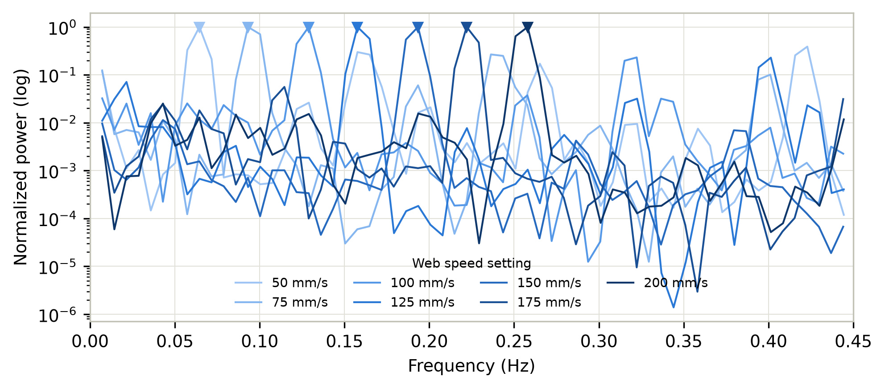
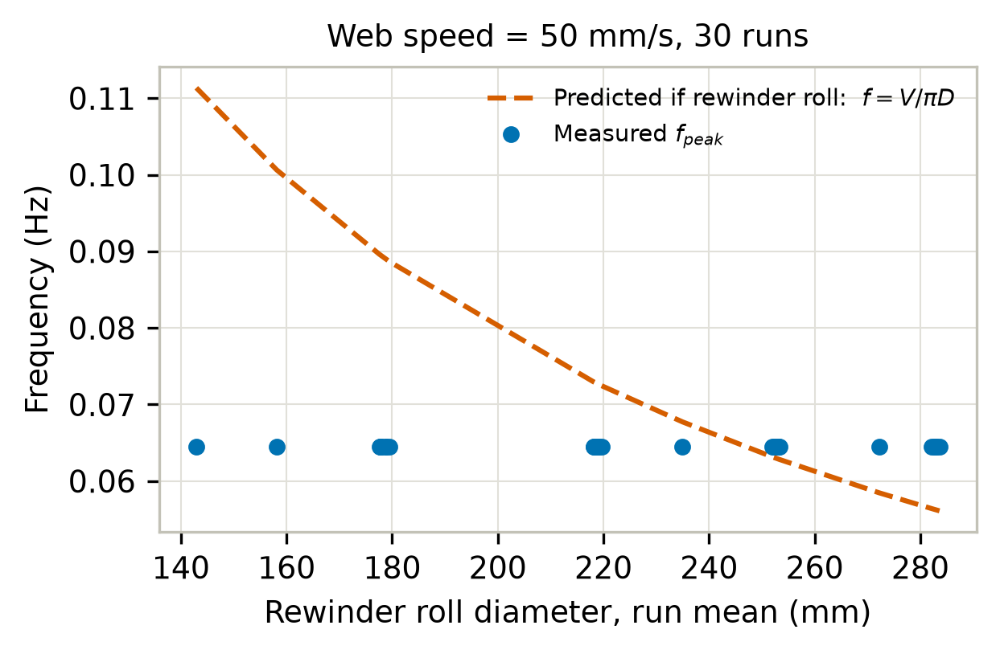
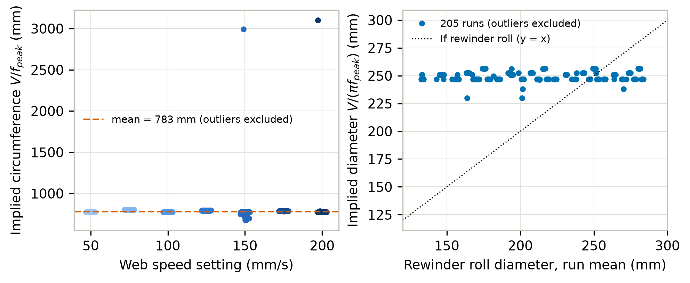
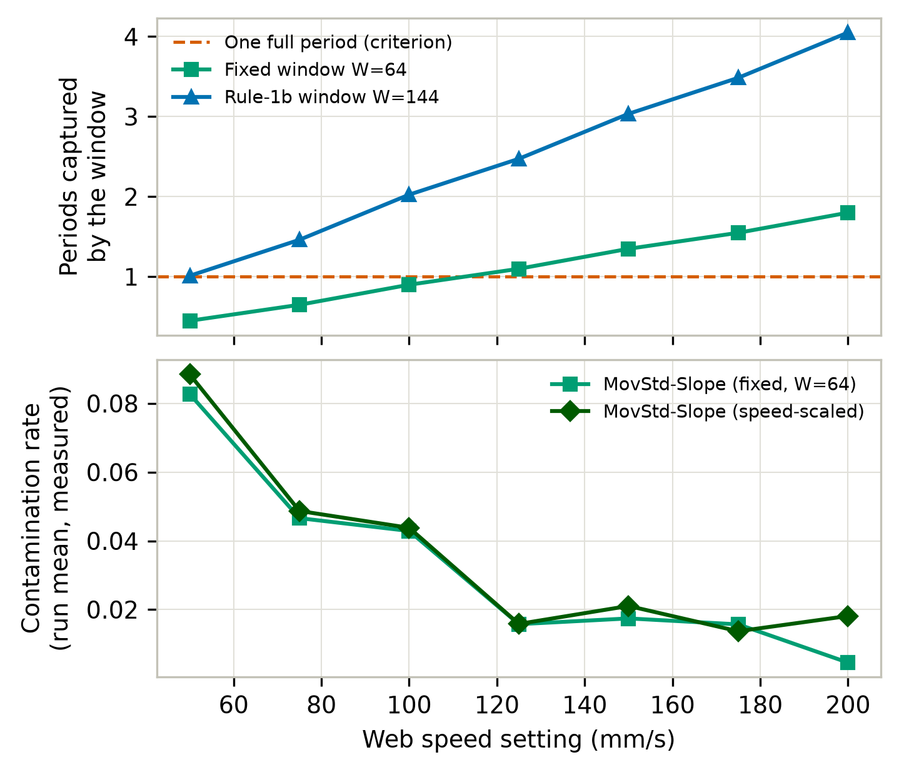
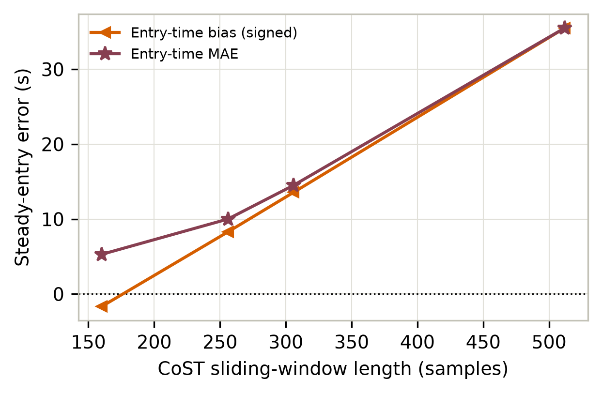

# steady 구간의 주기 성분 — "속도 ÷ 롤 둘레" 가 뜻하는 것

- 작성일: 2026-10-23
- 목적: steady 구간에 남아 있는 주기 성분이 **롤 회전 외란**으로 식별되는 근거와, 그것을 창 길이 유도에 쓰는 방법(규칙 1b)을 정리한다.
- 관련: `docs/research_plan.md` 1.2절(관찰 사실)·3.1절(차별점 D1)·10절(결정사항 6), `docs/hyperparameters.md`(창 길이 설정), `docs/outputs_guide.md`(결과 읽는 법)

---

## 1. 관찰 사실 — 주파수가 속도에 비례한다

steady 구간의 e 신호는 가만히 있지 않고 **느리게 진동한다.** 그 스펙트럼 최대 주파수가 웹 속도에 비례한다
(`research_plan.md` 1.2절):

| V (mm/s) | 50 | 75 | 100 | 125 | 150 | 175 | 200 |
|---|---|---|---|---|---|---|---|
| 최대 주파수 (Hz) | **0.06** | 0.10 | 0.13 | 0.16 | 0.19 | 0.22 | 0.26 |
| 주기 (s) | **16.7** | 10.0 | 7.7 | 6.3 | 5.3 | 4.5 | 3.8 |
| 주기 (샘플, fs≈9.174 Hz) | **153** | 92 | 71 | 57 | 48 | 42 | 35 |

"속도에 비례" 라는 사실만으로는 **왜** 그런지 모른다. 아래가 그 설명이다.

> **주의**: 이 표의 수치는 **라벨로 잘라낸 steady 구간**에서 측정된 것이라 설정값 유도에 쓸 수 없다(§4.2).
> §6 에서 라벨 없이 다시 측정해 대체했다. 이 표는 "현상이 존재한다" 는 관찰 증거로만 쓴다.

---

## 2. 속도 ÷ 롤 둘레 = 롤의 회전 주파수

단위를 보면 바로 나온다:

```
(mm/s) ÷ (mm) = 1/s = Hz
```

리와인더 롤이 필름을 감는다. 필름은 웹 속도 V (mm/s) 로 흐르고 롤 둘레가 C (mm) 이면,
**롤은 C/V 초마다 한 바퀴 돈다.** 즉 회전 주파수는

```
f_rot = V / C = V / (π·D)        D = 롤 지름
```

| 예 | 계산 | 회전 주파수 |
|---|---|---|
| V = 50 mm/s, C = 800 mm | 16 s 마다 1회전 | **0.0625 Hz** |
| V = 200 mm/s, C = 800 mm | 4 s 마다 1회전 | **0.25 Hz** |

관찰값은 0.06 Hz / 0.26 Hz 다. **거의 일치한다.**

### 관찰 주파수를 둘레로 역산하면

`C = V / f` 로 거꾸로 계산하면 둘레가 나온다. 속도 7수준 모두에서 **거의 일정해야** 회전 외란 가설이 성립한다:

| V (mm/s) | 50 | 75 | 100 | 125 | 150 | 175 | 200 |
|---|---|---|---|---|---|---|---|
| 환산 둘레 (mm) | 833 | 750 | 769 | 781 | 789 | 795 | 769 |
| 환산 지름 (mm) | 265 | 239 | 245 | 249 | 251 | 253 | 245 |

**둘레 750–833 mm (평균 784 mm), 지름 239–265 mm (평균 250 mm) 로 거의 일정하다.**
(이 역산도 §1 의 라벨 유도 수치에서 나온 것이다. 라벨 없이 다시 측정한 값은 §6.3 의 **783.5 mm / 249.4 mm** 이고 거의 같다.)
둘레 800 mm 를 가정하면 예측 주파수가 관찰과 **1–6% 오차**로 맞는다:

| V | 50 | 75 | 100 | 125 | 150 | 175 | 200 |
|---|---|---|---|---|---|---|---|
| 예측 `V/800` (Hz) | 0.062 | 0.094 | 0.125 | 0.156 | 0.188 | 0.219 | 0.250 |
| 관찰 (Hz) | 0.06 | 0.10 | 0.13 | 0.16 | 0.19 | 0.22 | 0.26 |
| 오차 | 4% | 6% | 4% | 2% | 1% | 1% | 4% |

---

## 3. 왜 회전 주파수가 장력 신호에 나타나는가

롤이 완벽한 원이 아니거나 중심이 틀어져 있으면(**편심**), 또는 롤 표면에 이음새·단차가 있으면,
**한 바퀴 돌 때마다 유효 권취 반경이 미세하게 변한다.**

반경이 변하면 그 순간 필름을 당기는 양(권취 선속도)이 달라지고, 폐루프 제어가 보정하기까지
**장력이 1회전당 1번 흔들린다.** 그래서 e 신호에 회전 주파수의 주기 성분이 실린다.

속도를 올리면 롤이 빨리 돌므로 **그 성분의 주파수도 비례해 올라간다.** 관찰된 `f_peak ∝ V` 가 이것으로 설명된다.

> 이 성분은 **steady 상태에서도 사라지지 않는다.** 설비가 정상적으로 안정 운전 중일 때도 롤은 계속 돌기 때문이다.
> 즉 "정상상태인데도 신호가 진동한다" 는 것이 본 데이터의 성질이고, 이것이 아래 D1 문제를 만든다.

---

## 4. 왜 중요한가 — 세 가지

### 4.1 경험적 상관을 물리 기전으로 바꿔준다

"주파수가 속도에 비례한다" 는 상관관계일 뿐이다. 회전 주파수로 식별되면 **왜 그런지**에 답이 생기고,
조건이 바뀌었을 때 어떻게 변할지 **예측**할 수 있다.

### 4.2 라벨 없이 주파수를 계산할 수 있다 — 지금 당장의 실익

현재 1.2절의 주파수는 **"run별 steady 앞 1024 샘플"** 의 스펙트럼에서 측정했다. 그런데 "steady 가
어디서 시작하는지" 를 알아야 그 구간을 잘라낼 수 있고, 그것은 `Trigger 4` **라벨**이다.
즉 **지금 상태로 창 길이를 유도하면 라벨에서 유도한 것이 되어 `research_plan.md` 0절
("하이퍼파라미터 선택에도 라벨을 사용하지 않는다")을 위반한다.**

회전 주파수로 계산하면 이 문제가 사라진다:

```
f_min = V_min / (π·D)        V_min = 50 mm/s (설정값, 알려짐)
                             D     = 롤 지름 (장비 정보, 알려짐)
```

둘 다 `research_plan.md` 0절이 **"사용 가능"** 으로 분류한 정보다(장력 신호, 장비 설정값, 정상상태의 일반적 정의).
라벨이 전혀 들어가지 않는다.

### 4.3 일반화 논거가 된다

`research_plan.md` 3.1 (4)의 "R2R 한 사례" 비판 완화다. 회전체를 쓰는 폐루프 제어 공정이면
같은 성질(회전 동기 외란 + 설정값 추종)이 있을 가능성이 있다. 다만 이것은 **추정이고 문헌 확인이 필요**하다.

---

## 5. 창 길이 유도에의 적용 (규칙 1b)

### 5.1 논리

| 단계 | 내용 |
|---|---|
| ① | steady 구간에도 회전 외란 주기 성분이 있다 (§1–3) |
| ② | **창이 1주기보다 짧으면** 그 안에서 느린 진동이 "추세(기울기)" 로 보인다. 사인파의 1/4 토막만 보면 올라가는 직선처럼 보이는 것과 같다 → "추세가 있으니 비정상" 으로 오판 |
| ③ | 따라서 `W ≥ fs / f_min` — 가장 느린 조건(V=50)의 1주기를 담아야 한다 |
| ④ | **창이 길면** causal 창이 과도구간을 창 길이만큼 "기억" 해서 steady 진입 판정이 그만큼 늦어진다 |
| ⑤ | 하한은 ③이 정하고 상한 방향은 ④가 벌점을 준다 → **하한을 택한다** |

②는 `research_plan.md` 3.1 의 **D1 가설**이고, 실측으로 확인됐다 — MovStd-Slope 고정창(64 샘플)이
1주기를 못 담는 V=50/75/100 에서 오염률 0.043–0.083, 담는 V≥125 에서 0.005–0.017 로 **2.5~5배 차이**다.

④도 실측됐다 — CoST 의 steady 진입 bias 가 창 길이에 비례해 커진다(W=160 에서 −1.7 s,
W=512 에서 **+35.5 s**, 창 길이 55.8 s 의 0.64배).

### 5.2 확정값은 §7 에 있다

이 절에는 원래 "둘레를 몰라서 창이 138~164 중 어디로든 정해질 수 있다" 는 표가 있었다.
§6 의 측정으로 둘레가 **783.5 mm** 로 확정되었고, 창 길이는 **144 샘플**이 되었다.
유도 과정과 근거 그림은 **§7** 을 보라.

---

## 6. 검증 — 라벨 없이 210 run 전체를 측정했다 (2026-10-23)

§1 의 수치는 **라벨로 잘라낸 steady 구간**에서 측정한 것이라 그대로 쓸 수 없었다(§4.2).
그래서 **run 전체 신호**로 다시 측정했다. 구현: `code/02_eda/01_rotation_frequency.py`,
결과: `outputs/02_eda/01_rotation_frequency.csv` + 그림 5종.

측정 방법: run 1개의 e 에서 평균을 빼고 Hann 창을 적용한 뒤 단측 파워 스펙트럼을 구하고,
0.03–0.30 Hz 범위에서 파워가 가장 큰 주파수를 회전 1차 성분으로 본다.
**steady 구간을 잘라내지 않으므로 `Trigger 4` 가 개입하지 않는다.**

### 6.1 그림 1 — 주기 성분이 존재하고 주파수가 속도에 비례한다



`outputs/02_eda/01_spectrum_by_speed.png` — 리와인더 장력 4 kg 조건의 대표 run 7개(속도 7수준)의
정규화 파워 스펙트럼이다. 가로축 주파수(Hz), 세로축은 각 run 의 최댓값으로 정규화한 파워(로그 눈금),
색은 속도(밝음 = 저속 → 어두움 = 고속), 삼각 표식이 검출된 `f_peak` 다.

**해석**: 봉우리가 속도에 따라 **오른쪽으로 질서 있게 이동한다**(0.064 → 0.258 Hz). 속도가 바뀌면
주기 성분의 주파수가 바뀐다는 뜻이고, 이것이 §2 의 회전 외란 가설의 1차 근거다. 라벨 없이 측정해도
§1 의 관찰(0.06 → 0.26 Hz)이 재현된다.

### 6.2 그림 2 — 리와인더 롤 가설은 **반박된다**



`outputs/02_eda/02_rewinder_hypothesis_test.png` — 속도를 50 mm/s 로 고정한 30 run 이다.
가로축은 그 run 의 리와인더 롤 지름(run 평균), 세로축은 주파수. 점은 **측정된** `f_peak`,
파선은 **리와인더 롤이 원인이라면 나와야 하는** 예측값 `f = V/(πD)` 다.

논리: `f = 속도 ÷ 둘레` 이므로 **같은 속도에서 지름이 다르면 주파수도 달라야 한다.**

| | 값 |
|---|---|
| 리와인더 지름 범위 (30 run) | **143 → 284 mm (약 2배)** |
| 예측 `f` 범위 (파선) | 0.111 → 0.056 Hz (변동계수 **0.204**) |
| **측정 `f_peak` 범위 (점)** | **0.064 → 0.065 Hz (변동계수 0.000)** |
| `corr(f_peak, 1/D)` | **−0.233** (비례해야 하는데 상관이 없고 부호도 반대) |

**해석**: 리와인더 지름이 2배 변하는데 측정 주파수는 움직이지 않는다. **외란의 출처는 리와인더 롤이 아니다.**
지름이 변하지 않는 **고정 지름 회전체**다. §6.4 의 가능성 #3 이 맞다.

### 6.3 그림 3 — 역산 둘레가 전 조건에서 일정하다



`outputs/02_eda/03_circumference_consistency.png` — 왼쪽은 속도별 역산 둘레 `V/f_peak`(점 = run,
파선 = 전체 평균), 오른쪽은 리와인더 지름(가로) 대 역산 지름(세로)이고 점선이 `y = x`(리와인더 가설).

| 속도 (mm/s) | 50 | 75 | 100 | 125 | 150 | 175 | 200 |
|---|---|---|---|---|---|---|---|
| `f_peak` 중앙값 (Hz) | 0.064 | 0.093 | 0.129 | 0.158 | 0.193 | 0.222 | 0.258 |
| 주기 (s) | 15.5 | 10.7 | 7.8 | 6.3 | 5.2 | 4.5 | 3.9 |
| 주기 (샘플) | **142** | 99 | 71 | 58 | 47 | 41 | 36 |
| **역산 둘레 (mm)** | **776** | **806** | **775** | **793** | **776** | **788** | **775** |
| 둘레 표준편차 (mm) | 0.30 | 0.30 | 0.38 | 0.31 | 15.74 | 0.70 | 2.23 |
| run 수 | 30 | 30 | 30 | 30 | 26 | 30 | 29 |

**해석**:
- **속도 5수준에서 둘레 표준편차가 1 mm 미만**이다. 같은 속도의 run 30개가 리와인더 지름이 2배씩 달라도 둘레가 소수점 첫째 자리까지 같다 — 고정 지름 회전체라는 결론이 매우 강하다.
- 속도별 중앙값 범위는 775–806 mm(±2%)다. 주파수 해상도 `fs/n = 0.0072 Hz` 가 둘레에 ±6% 불확실성을 주므로, 이 변동은 **해상도 안에서 설명된다**(실제 둘레가 하나라는 가설과 모순되지 않는다).
- 오른쪽 그림에서 점들이 `y = x` 선에서 완전히 떨어져 **수평으로 늘어선다.** 역산 지름이 리와인더 지름과 무관하게 249 mm 근처에 고정돼 있다는 뜻이다.
- **전체: 둘레 783.5 ± 13.1 mm, 지름 249.4 mm** (이상치 5 run 제외, 205/210).

### 6.4 둘레 이상치 5개 — 이미 알고 있는 run 들이다

역산 둘레가 속도별 중앙값에서 10% 이상 벗어난 run 5개다 (CSV 의 `circumference_outlier` 열):

| run | V | `f_peak` (Hz) | 역산 둘레 (mm) | 사유 |
|---|---|---|---|---|
| `T3_R2_V200` | 200 | 0.064 | 3,103 | **진폭 이상 run.** e 범위 −1.01~+2.87 kg (전형 run 은 ±0.25) |
| `T4_R6_V150` | 150 | 0.050 | 2,992 | **진폭 이상 run.** e 범위 −2.06~+0.61 kg |
| `T5_R5_V150` | 150 | 0.222 | 676 | V=175 의 주파수를 잡았다 (한 bin 차이) |
| `T6_R3_V150` | 150 | 0.222 | 676 | 동일 |
| `T7_R5_V150` | 150 | 0.215 | 698 | 동일 |

앞의 2개는 `research_plan.md` 1.2절에 기록한 **진폭 이상 run** 과 **정확히 같은 run** 이다.
그 run 들은 스펙트럼이 이상 진폭의 저주파 성분에 지배되어 회전 성분을 찾지 못한다.
뒤의 3개는 인접 주파수 bin 을 잡은 해상도 문제다.

**즉 이상치 5개 모두 원인이 설명되며, 고정 지름 롤러라는 결론을 흔들지 않는다.**

### 6.5 남은 미확정 — 어느 롤러인가

알아낸 것은 **"지름 ≈ 249 mm 인 고정 지름 회전체"** 라는 것이고, **그것이 장비의 어느 롤러인지는 모른다.**
원본 데이터에 지름이 기록된 롤러는 리와인더 하나뿐이고(그리고 그것은 아니다),
나머지(`Master roll`, `Un-Winder`, `Feeder`)는 **속도만 기록돼 있고 지름이 없다.**

특정하려면 장비 도면·사양서의 롤러 지름 목록이 필요하다 (`research_plan.md` 10절 결정사항 5).
**창 길이 유도에는 영향이 없다** — 필요한 것은 둘레 값 하나이고 그것은 측정됐다.

### 6.6 `Rewinder roll diameter` 열에 대해 알게 된 것

사용 승인을 받아 확인한 결과(210 run 전체):

| 항목 | 값 |
|---|---|
| 전체 범위 | **132.6 ~ 287.1 mm** (`research_plan.md` 3.1 의 "약 275–283 mm" 는 일부 run 만 본 값) |
| run 평균 지름 범위 | 132.6 ~ 283.6 mm (중앙 214.3) |
| **run 안에서의 증가량** | **−0.5 ~ +14.6 mm (중앙 +5.1)** — 필름이 감기며 롤이 자란다 |
| 설정값(T, R, V) 3개로 선형회귀한 R² | **0.144** |

**해석**: R² = 0.144 는 이 열이 **운전조건으로 거의 설명되지 않는다**는 뜻이다. 즉 "그 run 을 기록할 때
필름이 얼마나 감겨 있었나" 를 나타내는 값이고, `research_plan.md` 가 L6 로 지목한
**run 수집 순서 교란**에 해당한다.

**이 열은 모델 입력에 넣지 않는다.** 이유 3가지:

1. **외란의 출처가 아니다**(§6.2). 모델에 줄 물리적 이유가 없다.
2. **수집 순서 교란이다**(R² = 0.144). 운전조건 정보가 아니다.
3. **run 식별자로 작동한다.** 지름이 132~287 mm 연속 분포로 run 마다 거의 고유하므로, 인코더가 이 값을 보면 "지금 몇 번째 run 인지" 를 부분적으로 알아낼 수 있다. 미학습 조건 일반화를 보려는 실험에서 run 신원을 알려주는 입력은 **지름길(shortcut)** 이 되어 결과를 무효화한다.

또 `research_plan.md` 158행의 공정성 조건이 **"동일 입력"** 이므로, 제안 방법에만 주면 비교가 깨지고
모든 비교군에 주면 전체 재실행이다. **이 열은 창 길이를 찾는 진단에만 썼다** — `fs`(샘플링 주파수)를
쓰는 것과 같은 지위이고, 모델은 여전히 `e` 하나만 입력받는다.

---

## 7. 창 길이 유도 — 최종

### 7.1 유도

```
C     = 783.5 mm                       역산 둘레 (205 run 평균, 지름 249.4 mm)   §6.3
f_min = V_min / C = 50 / 783.5
      = 0.0638 Hz                      최저 속도(50 mm/s)에서의 회전 주파수
W     = ⌈ fs / f_min ⌉ = ⌈ 9.174 / 0.0638 ⌉
      = 144 samples (15.7 s)
```

**W = 144 ± 8 samples** (주파수 해상도 `fs/n = 0.0072 Hz` 에서 오는 불확실성).

### 7.2 하한 근거 — 왜 1주기 이상이어야 하는가

창이 1주기보다 짧으면 **그 안에서 느린 진동이 "추세" 로 보인다.** 사인파의 1/4 토막만 보면
올라가는 직선처럼 보이는 것과 같다. 그러면 "추세가 있으니 비정상" 으로 오판한다.
`research_plan.md` 3.1 의 **D1 가설**이고, 실측으로 확인된다.



`outputs/02_eda/04_window_lower_bound.png` — 위 패널은 창이 담는 주기 수(가로축 속도, 세로축
`창 길이 ÷ 주기`, 붉은 파선이 기준선 1.0), 아래 패널은 **같은 속도축에서 실측된 오염률**이다.
축을 공유하므로 위아래를 그대로 겹쳐 읽으면 된다.

| V (mm/s) | 50 | 75 | 100 | 125 | 150 | 175 | 200 |
|---|---|---|---|---|---|---|---|
| 주기 (샘플) | 142 | 99 | 71 | 58 | 47 | 41 | 36 |
| **고정창 64 가 담는 주기** | **0.45** | **0.65** | **0.90** | 1.10 | 1.35 | 1.55 | 1.80 |
| 실측 오염률 (고정창) | **0.083** | **0.047** | **0.043** | 0.016 | 0.017 | 0.016 | 0.005 |
| **규칙 1b 창 144 가 담는 주기** | 1.01 | 1.46 | 2.02 | 2.47 | 3.04 | 3.49 | 4.05 |

**해석**: 고정창 64 가 1주기를 **못 담는** 세 속도(50/75/100)에서 오염률이 0.043–0.083 이고,
**담는** 네 속도(125 이상)에서 0.005–0.017 이다. **2.5~5배 차이**이고, 경계가 기준선 1.0 과 일치한다.
이것이 "창은 최소 1주기를 담아야 한다" 는 하한의 실측 근거다.

### 7.3 상한 방향 근거 — 왜 하한에서 멈추는가

causal 창은 과도구간을 **창 길이만큼 "기억"** 하므로 steady 진입 판정이 그만큼 늦어진다.



`outputs/02_eda/05_window_upper_bound.png` — CoST 창 4종의 steady 진입 오차다. 가로축 창 길이(샘플),
세로축 오차(초). 부호 포함 bias 와 절댓값 MAE 를 함께 그렸고, 점선이 0 이다.

| CoST 창 (샘플) | 160 | 256 | 306 | 512 |
|---|---|---|---|---|
| 창 길이 (s) | 17.4 | 27.9 | 33.4 | 55.8 |
| 진입 bias (s) | **−1.7** | +8.3 | +13.6 | **+35.5** |
| 진입 MAE (s) | **5.3** | 10.0 | 14.5 | **35.5** |

**해석**: bias 가 창 길이에 따라 단조 증가하고 **전부 양수**다(= 전문가보다 늦게 steady 선언).
W=512 의 35.5 s 지연은 창 길이 55.8 s 의 **0.64배**다. 즉 지연의 크기가 창 길이에 비례한다.
창을 키우면 진입 시점 지표가 직접 벌점을 받는다.

> 주의: 이 표에는 §9 에 적은 **학습량 교란**이 섞여 있다. CoST 는 `max_train_length = W` 때문에
> 창이 길수록 같은 600 iter 에서 데이터를 더 많이 통과한다(3.57 → 14.29회). 다만 진입 지연이
> 창 길이의 0.64배라는 **비례 관계**는 창 길이의 직접 효과로 보는 것이 자연스럽다.

### 7.4 결론

하한은 데이터가 정하고(1주기 = 144 샘플), 그보다 키우면 진입 지표가 벌점을 받는다.
**그래서 하한에서 멈춘다 — W = 144 samples (15.7 s).**

라벨은 쓰지 않았다. 입력은 ① 속도 설정값(알려진 값) ② run **전체** 스펙트럼 두 가지뿐이고,
`Trigger 4` 가 어디에도 개입하지 않는다.

### 7.5 속도별 창 변형

같은 논리를 속도마다 적용한다. `W(V) = ⌈fs / (V/C)⌉ = ⌈fs·C/V⌉`:

| V (mm/s) | 50 | 75 | 100 | 125 | 150 | 175 | 200 |
|---|---|---|---|---|---|---|---|
| **규칙 1b `W(V)`** | **144** | **96** | **72** | **58** | **48** | **42** | **36** |
| 현재 (`64×125/V`, 임의 기준값) | 160 | 107 | 80 | 64 | 53 | 46 | 40 |

현재 값은 규칙 1b 의 약 1.11배이고, 그 1.11 이 **임의 상수 64 에서 나온 수치**다.
규칙 1b 를 쓰면 임의 상수(`WINDOW=64`, `SPEED_REF=125`)가 **둘 다 사라진다.**

---

## 8. (참고) 검증 전에 열려 있던 가능성 3가지 — 모두 해소됨

검증 전에는 신호 역산 지름(250 mm)과 기록된 `Rewinder roll diameter`(당시 "275–283 mm" 로 알고 있었다)의
불일치 원인으로 3가지가 열려 있었다. §6 의 측정으로 모두 결론이 났다.

| # | 가능성 | 결론 |
|---|---|---|
| 1 | 기록된 지름이 코어/플랜지 지름이고 유효 권취 반경이 다르다 | **무의미해졌다.** 코어든 유효 반경이든 리와인더 자체가 출처가 아니다 (§6.2) |
| 2 | 롤이 감기며 지름이 커진다 | **사실이지만 원인이 아니다.** 지름은 실제로 run 안에서 자란다(중앙 +5.1 mm, 최대 +14.6 mm). 그런데 주파수가 그것을 따라가지 않는다 (§6.2, §6.6) |
| 3 | **출처가 리와인더가 아닌 다른 롤러다** | **맞다.** 리와인더 지름이 143→284 mm 로 2배 변해도 주파수가 0.064–0.065 Hz 로 고정이다. 지름 ≈ 249 mm 의 **고정 지름 회전체**다 (§6.2, §6.3) |

남은 것은 **그것이 어느 롤러인가** 뿐이고(§6.5), 창 길이 유도에는 영향이 없다.

부수적으로 `research_plan.md` 3.1 의 "`Rewinder roll diameter` 약 275–283 mm" 서술이 **일부 run 만 본
값이었음**이 드러났다. 실제 범위는 132.6–287.1 mm 다 (§6.6). 해당 문서를 정정해야 한다.

---

## 9. 한계와 주의

1. **주기를 담는 것만으로 저속 문제가 해결되지는 않는다.** MovStd-Slope 속도별창은 모든 속도에서 1주기 이상을 담는데도 저속 오염률이 고정창과 사실상 같다(V=50 에서 0.088 vs 0.083). 즉 **창 길이 1주기는 필요조건일 수 있으나 충분조건이 아니다.**
2. **같은 창 길이에서도 표현 방식이 성능을 좌우한다.** CoST W=160 은 MovStd-Slope 속도별창의 V=50 창(160 샘플)과 길이가 **같은데** 저속 오염률이 0.016 대 0.088 로 5배 차이다. 2차원 (std, |기울기|) 과 320차원 CoST 표현의 차이다.
3. 따라서 **규칙 1b 의 가치는 "성능이 좋아진다" 가 아니라 "창 길이 교란을 제거해 표현 방식의 차이만 남긴다" 는 공정성에 있다.** 위 2번 비교가 그 가치를 보여주는 예다.
4. 스펙트럼 최대 주파수는 **회전 1차 성분**만 본 것이다. 고조파(2f, 3f)나 다른 롤러의 성분이 섞여 있을 수 있고 확인하지 않았다.
5. **주파수 해상도가 창 길이 정밀도의 한계다.** run 길이가 약 1,288 샘플(140 s)이라 해상도가 `fs/n = 0.0072 Hz` 이고, 이것이 둘레에 ±6%, 창 길이에 **±8 샘플** 불확실성을 준다. 더 올리려면 더 긴 기록이나 여러 run 평균 스펙트럼(Welch)이 필요하다.
6. **진폭 이상 run 2개는 이 분석에서도 벗어난다**(§6.4). 그 run 들은 스펙트럼이 이상 진폭에 지배되어 회전 성분을 찾지 못한다. 창 길이 산출에서는 제외했으나, **평가에서는 210 run 전부를 유지한다**(사용자 결정).
7. §1 의 주파수 표는 **라벨로 자른 구간에서 측정된 것**이다. §6 이 그것을 라벨 없이 대체했으므로, §1 표는 "관찰로 식별을 뒷받침하는 증거" 로만 쓰고 **설정값 유도에는 §6 의 값을 쓴다.**
